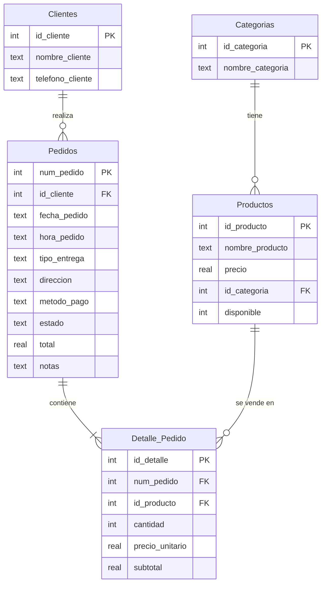

# Crazy Chicken – Base de datos, canasta y panel de pedidos

## 1. Dónde va cada archivo

```
tu-proyecto/
├── server.js            ← reemplaza el tuyo
├── schema.sql           ← NUEVO: estructura de la base de datos
├── datos_ejemplo.sql    ← NUEVO (opcional): pedidos de prueba
├── crazy_chicken.db     ← reemplaza el tuyo (base nueva y limpia)
├── package.json         ← trae "npm start"
└── public/
    ├── index.html       ← reemplaza el tuyo (mismo diseño + canasta)
    ├── carrito.js       ← NUEVO: lógica de la canasta
    ├── carrito.css      ← NUEVO: estilos de la canasta
    ├── admin.html       ← NUEVO: panel de pedidos
    ├── admin.js         ← NUEVO
    ├── estilos.css      ← el tuyo, sin cambios
    └── img/             ← tus imágenes, sin cambios
```

`app.js` y `basedatos.html` ya no se usan (eran una prueba de clientes); puedes borrarlos.

## 2. Cómo encenderlo

```
npm install
npm start
```

Abre **http://localhost:3000** (no abras el index.html con doble clic: sin el servidor no hay base de datos).
Panel del administrador: botón **Admin** de la página → usuario `admin@crazychicken`, contraseña `12345`.
Para cambiarlos: `ADMIN_USER=otro ADMIN_PASS=clave npm start` (en Windows PowerShell: `$env:ADMIN_PASS="clave"; npm start`).

Para cargar pedidos de prueba (una sola vez, con el servidor apagado):
`sqlite3 crazy_chicken.db < datos_ejemplo.sql` o pega el contenido en *DB Browser for SQLite* → Ejecutar SQL.

## 3. Cómo funciona un pedido

1. El cliente toca **+** en el menú → se guarda en su canasta (localStorage).
2. Toca el botón de la canasta → **Continuar** → escribe nombre, teléfono, tipo de entrega y pago.
3. El navegador envía a `POST /api/pedidos` solo los **id de producto y cantidades**.
4. El servidor busca los **precios en la base de datos**, calcula el total y guarda todo en una transacción
   (Clientes → Pedidos → Detalle_Pedido). Si algo falla, no se guarda nada.
5. El administrador ve el pedido en `admin.html`, cambia su estado y consulta los reportes.

## 4. Diagrama entidad-relación



## 5. Qué se corrigió respecto a tu `database.db`

| Problema | Solución |
|---|---|
| `Detalles` no tenía **cantidad** (no se sabía cuántas unidades se vendieron) | Nueva tabla `Detalle_Pedido` con cantidad, precio_unitario y subtotal |
| `hora_entrega` estaba en el detalle, pero es dato del pedido | Se reemplaza por `tipo_entrega`, `direccion` y `estado` en `Pedidos` |
| Precios como texto (`'20 bs '`, `'15bs'`) → no se pueden sumar | `precio REAL` (20, 15, 17.5…) |
| Fechas `'14/08/2026'` → no se ordenan ni filtran bien | Formato `AAAA-MM-DD` |
| Categorías y productos duplicados (23 categorías, 31 productos) | 5 categorías y 13 productos, sin repetir |
| Clientes repetidos por teléfono | `telefono_cliente UNIQUE` |
| Sin reglas de validación | `CHECK`, `NOT NULL` y claves foráneas (`FOREIGN KEY`) |
| Si el precio cambia, las ventas viejas cambiaban | Se guarda `precio_unitario` al momento de vender |

## 6. Consultas SQL útiles (para tu defensa del proyecto)

```sql
-- Ventas del día
SELECT COUNT(*) AS pedidos, SUM(total) AS vendido
FROM Pedidos WHERE fecha_pedido = date('now','localtime') AND estado <> 'Cancelado';

-- Productos más vendidos
SELECT pr.nombre_producto, SUM(d.cantidad) AS unidades
FROM Detalle_Pedido d JOIN Productos pr ON pr.id_producto = d.id_producto
GROUP BY pr.id_producto ORDER BY unidades DESC;

-- Mejores clientes
SELECT c.nombre_cliente, COUNT(*) AS pedidos, SUM(p.total) AS gastado
FROM Pedidos p JOIN Clientes c ON c.id_cliente = p.id_cliente
GROUP BY c.id_cliente ORDER BY gastado DESC;

-- Detalle completo de un pedido
SELECT p.num_pedido, c.nombre_cliente, pr.nombre_producto, d.cantidad, d.subtotal
FROM Pedidos p
JOIN Clientes c ON c.id_cliente = p.id_cliente
JOIN Detalle_Pedido d ON d.num_pedido = p.num_pedido
JOIN Productos pr ON pr.id_producto = d.id_producto
WHERE p.num_pedido = 1;
```

## 7. Cosas para tener en cuenta

- Los precios que ve el cliente en las tarjetas del menú son los de tu HTML, pero **el cobro usa los de la base de datos**.
  Si cambias un precio, cámbialo en las dos partes (o con `UPDATE Productos SET precio = 22 WHERE id_producto = 1;`).
- Los botones **+** usan el `data-id` de cada producto. Si agregas un producto nuevo al menú, insértalo en `Productos`
  y ponle al botón el `data-id` que le tocó.
- Siguiente paso posible: generar las tarjetas del menú desde `/api/productos` para no repetir precios.
